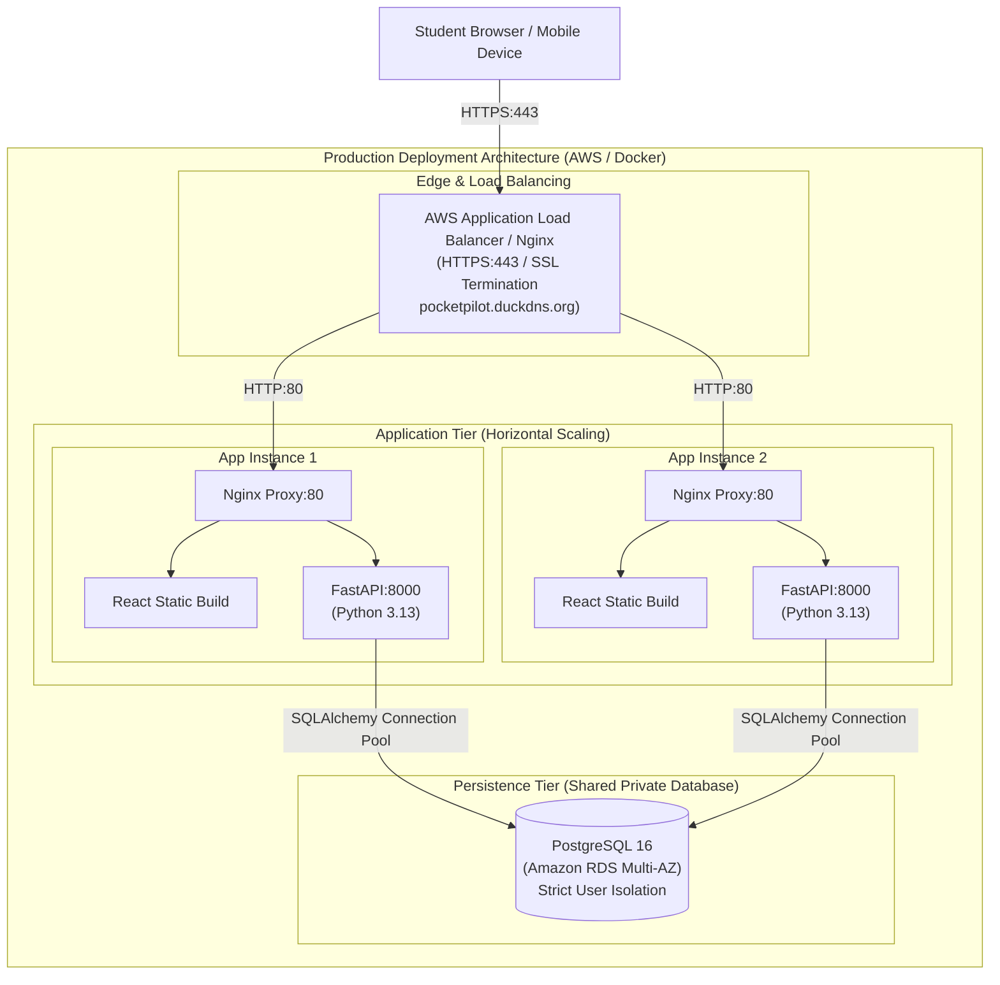

# PocketPilot — Student Expense Intelligence & Subscription Leak Detection System

[](https://www.python.org/)
[](https://fastapi.tiangolo.com/)
[](https://react.dev/)
[](https://tailwindcss.com/)
[](https://www.postgresql.org/)
[](https://www.docker.com/)
[]()

> A production-style, privacy-first financial intelligence platform tailored specifically for university students to eliminate subscription leaks, prevent overspending, and audit transactions with explainable statistical analytics.

---

## 1. Problem Statement

University students frequently face financial stress exacerbated by fragmented spending habits:
1. **Subscription Creep & Leaks**: Recurring software tools (Spotify, streaming, cloud storage, study aids) quietly drain bank accounts with unmonitored renewals.
2. **Impulse & High-Deviation Outliers**: Occasional large bookstore or entertainment spikes derail monthly allowances before students notice.
3. **Budget Ambiguity**: Students lack proactive, real-time warning systems that warn them when they are approaching or exceeding monthly limits.
4. **Opaque Financial Apps**: Many modern tools claim complex "AI/ML" without explaining why an alert was triggered, eroding trust and financial clarity.

**PocketPilot** solves this by combining end-to-end transaction tracking, dynamic category budgets, explainable cadence-based subscription intelligence, and leave-one-out statistical anomaly detection in a clean, responsive fintech interface.

---

## 2. Key Features

- **Executive Dashboard**:
  - Derived live figures: Total Monthly Spend, Monthly Allocated Budget, Remaining Balance, and Student Savings Rate.
  - Interactive Recharts Category Spending Donut Chart with percentage distributions.
  - 6-Month historical spending trend bar chart.
  - Real-time budget warning badges and active subscription commitments.
- **Transactions Management (Full CRUD)**:
  - Search across descriptions, merchants, and notes.
  - Category and date range filtering.
  - Create, view details, edit, and delete transactions with confirmation modals.
  - Strict input validation (positive amounts, ISO dates, mandatory fields).
- **Category Budgets**:
  - Monthly category spending caps with dynamic progress bars.
  - Real-time status indicators: Normal (<80%), Warning (80–99%), Exceeded (&ge;100%).
- **Subscription Intelligence Engine**:
  - Automated detection of recurring cadences (weekly, monthly, bi-weekly, annual).
  - Normalizes merchant tags and compares interval spacing ($\Delta t$).
  - Evaluates amount variance ($CoV$) to avoid classifying routine grocery/dining visits as subscriptions.
  - Categorizes candidates as High, Medium, or Potential confidence with plain-English rationales.
  - Ability to mark subscriptions as Active, Under Review, or Cancelled.
- **Explainable Anomaly Detection**:
  - Robust leave-one-out statistical baseline rules ($\mu_{-i} + 2.5\sigma_{-i}$) to prevent outlier masking.
  - Small-sample median multipliers for sparse student categories.
  - Transparent mathematical formulas displayed for every alert (no fictional ML claims).
- **Batch CSV Import Engine**:
  - Pre-flight validation preview table (shows valid vs. invalid rows before writing to DB).
  - Automatic column normalization (`trans_date` &rarr; `date`, `cost` &rarr; `amount`).
  - Strict duplicate detection to prevent duplicate imports across uploads.
  - Built-in one-click download for sample student expense CSV files.
- **Enterprise-Grade Security & Isolation**:
  - Secure bcrypt password hashing (12 rounds).
  - JWT token authentication with user-scoped database queries (User A can never view, edit, or delete User B's data).
  - Security headers (nosniff, DENY, XSS protection, HSTS).
  - Safe error handling that never leaks database credentials or stack traces.

---

## 3. Technology Stack

### Frontend
- **Framework**: React 18 with Vite
- **Styling**: Tailwind CSS (custom fintech theme with navy, indigo, emerald, amber, and rose accents)
- **Charts**: Recharts (Donut PieChart, BarChart, ResponsiveContainer)
- **Icons**: Lucide React
- **HTTP Client**: Native Fetch API client with automatic token injection and error handling

### Backend
- **Framework**: Python 3.13 FastAPI (asynchronous REST APIs)
- **ORM**: SQLAlchemy 2.0 with connection pooling
- **Validation**: Pydantic v2 schemas and SettingsConfigDict
- **Data Analysis**: Pandas for CSV file parsing and tabular validation
- **Security**: PyJWT and bcrypt
- **Server**: Uvicorn ASGI server

### Infrastructure & Deployment
- **Containerization**: Docker & Docker Compose
- **Web Server & Gateway**: Nginx Alpine with reverse proxy, SPA fallback, and security headers
- **Database**: PostgreSQL 16 (with SQLite support for rapid local testing)
- **Cloud Architecture**: AWS EC2 multi-instance compatibility, AWS Application Load Balancer (ALB) HTTPS termination, and DuckDNS domain configuration (`pocketpilot.duckdns.org`).

---

## 4. Architecture Diagram



---

## 5. Project Directory Structure

```
PocketPilot/
├── backend/
│   ├── app/
│   │   ├── __init__.py
│   │   ├── main.py                    # FastAPI entrypoint, middleware, exception handlers
│   │   ├── config.py                  # Pydantic BaseSettings environment configuration
│   │   ├── database.py                # SQLAlchemy engine, session maker, base model
│   │   ├── seed.py                    # Synthetic student demo data generator CLI
│   │   ├── models/                    # SQLAlchemy database models
│   │   │   ├── __init__.py
│   │   │   ├── user.py
│   │   │   ├── transaction.py
│   │   │   ├── budget.py
│   │   │   └── subscription.py
│   │   ├── schemas/                   # Pydantic v2 validation schemas
│   │   │   ├── __init__.py
│   │   │   ├── user.py
│   │   │   ├── transaction.py
│   │   │   ├── budget.py
│   │   │   ├── subscription.py
│   │   │   ├── insight.py
│   │   │   └── csv_import.py
│   │   ├── services/                  # Business logic and analytical algorithms
│   │   │   ├── __init__.py
│   │   │   ├── auth.py                # Password hashing, JWT token creation and extraction
│   │   │   ├── subscription_detector.py # Explainable interval & variance detection
│   │   │   ├── anomaly_detector.py    # Robust leave-one-out statistical outlier detection
│   │   │   ├── budget_service.py      # Category spend vs limits & status computation
│   │   │   └── csv_service.py         # Pandas CSV parsing, preview, and deduplication
│   │   └── routers/                   # REST API controllers
│   │       ├── __init__.py
│   │       ├── health.py
│   │       ├── auth.py
│   │       ├── transactions.py
│   │       ├── budgets.py
│   │       ├── subscriptions.py
│   │       ├── analytics.py
│   │       └── csv_import.py
│   ├── tests/                         # Pytest automated test suite
│   │   ├── __init__.py
│   │   ├── conftest.py
│   │   ├── test_health.py
│   │   ├── test_auth.py
│   │   ├── test_transactions.py
│   │   ├── test_budgets.py
│   │   ├── test_subscriptions.py
│   │   ├── test_analytics_and_anomalies.py
│   │   ├── test_csv_import.py
│   │   └── test_user_isolation.py
│   ├── pytest.ini
│   ├── requirements.txt
│   └── Dockerfile
├── frontend/
│   ├── src/
│   │   ├── api/
│   │   │   └── client.js              # Centralized API fetch wrapper
│   │   ├── components/                # Reusable UI widgets
│   │   │   ├── Navbar.jsx
│   │   │   ├── Sidebar.jsx
│   │   │   ├── StatCard.jsx
│   │   │   ├── Modal.jsx
│   │   │   ├── AlertBanner.jsx
│   │   │   └── EmptyState.jsx
│   │   ├── context/
│   │   │   └── AuthContext.jsx        # Authentication and session state
│   │   ├── pages/
│   │   │   ├── Login.jsx
│   │   │   ├── Register.jsx
│   │   │   ├── Dashboard.jsx
│   │   │   ├── Transactions.jsx
│   │   │   ├── Budgets.jsx
│   │   │   ├── Subscriptions.jsx
│   │   │   ├── Insights.jsx
│   │   │   └── CsvImport.jsx
│   │   ├── App.jsx
│   │   ├── main.jsx
│   │   └── index.css
│   ├── index.html
│   ├── vite.config.js
│   ├── tailwind.config.js
│   ├── postcss.config.js
│   ├── package.json
│   ├── nginx.conf                     # Frontend container Nginx config
│   └── Dockerfile
├── nginx/
│   └── default.conf                   # Reverse proxy configuration
├── data/
│   └── sample_student_expenses.csv    # Sample dataset for CSV import testing
├── docs/
│   ├── architecture.md                # System design & component specification
│   ├── aws-deployment.md              # Detailed AWS ALB, EC2, RDS deployment guide
│   └── security.md                    # Cryptography & security controls
├── docker-compose.yml
├── .dockerignore
├── .gitignore
├── .env.example
└── README.md
```

---

## 6. Analytical Algorithms & Rules

### A. Subscription Detection Engine
The subscription intelligence engine evaluates transaction history using deterministic, explainable rules:
1. **Merchant Normalization**: Strips variable descriptors, card masking identifiers (e.g. `*1234`), and corporate suffixes (`LLC`, `Inc`, `Corp`).
2. **Interval Spacing Evaluation ($\Delta t$)**:
   - Monthly cycle: $25 \le \Delta t \le 35$ days ($\sigma_{\Delta t} \le 6$ days).
   - Weekly cycle: $6 \le \Delta t \le 8$ days ($\sigma_{\Delta t} \le 2$ days).
   - Bi-weekly cycle: $13 \le \Delta t \le 16$ days ($\sigma_{\Delta t} \le 3$ days).
   - Annual cycle: $340 \le \Delta t \le 380$ days.
3. **Amount Stability**:
   - Coefficient of Variation ($CoV = \frac{\sigma}{\mu}$):
     - $CoV < 0.05$: **High Confidence (95%)** &mdash; identical charges (e.g. Spotify \$5.99/mo).
     - $0.05 \le CoV < 0.15$: **Medium Confidence (70%)** &mdash; slight variation due to tax or fluctuating tier.
     - $CoV \ge 0.15$: **Potential (40%)** &mdash; variable amounts spaced periodically (e.g. weekly coffee/grocery shopping); flagged explicitly as potential regular spending rather than a definitive subscription.

### B. Statistical Anomaly Detection
Rather than making false claims of an opaque machine learning model, PocketPilot uses **robust leave-one-out statistical rules**:
- **Peer Group Baseline**: For categories with $\ge 4$ transactions, candidate transaction $t_i$ is compared to the peer mean $\mu_{-i}$ and standard deviation $\sigma_{-i}$ of all other transactions in that category. This prevents the outlier from inflating the variance and hiding itself.
- **Threshold Rule**: Flags a transaction when $t_i > \mu_{-i} + 2.5 \times \max(\sigma_{-i}, 10.0)$ and $(t_i - \mu_{-i}) \ge \$35.00$.
- **Small Sample Rule**: In categories with 2–3 transactions, flags purchases exceeding $2.5 \times \text{category median}$ and $\ge \$50.00$.
- **Plain-English Explanation**: Every alert includes both the human-readable explanation and the exact mathematical numbers ($\mu$, $\sigma$, threshold).

### C. Budget Monitoring
- Compares actual category expenditures against configured monthly limits.
- Statuses:
  - `normal`: Spending $< 80\%$ of budget limit.
  - `warning`: Spending $\ge 80\%$ and $< 100\%$ of budget limit (approaching cap).
  - `exceeded`: Spending $\ge 100\%$ of limit (alert).

---

## 7. Synthetic Student Dataset

PocketPilot includes a reproducible seeding tool (`python -m app.seed`) generating realistic, entirely synthetic student transactions.

> **Disclaimer**: All generated records (e.g. Alex Chen, Campus Bookstore, Spotify Student, Trader Joe's) are completely synthetic and simulated for demonstration purposes. They do not represent real banking data.

### Seeded Profiles:
- **Demo User**: `demo@student.edu`
- **Demo Password**: `PocketPilot2026!`
- **Sample Categories**: Food & Dining, Books & Supplies, Subscriptions, Housing & Utilities, Entertainment, Transportation, Personal Care.
- **Pre-Configured Scenarios**:
  - Regular subscriptions: Spotify ($5.99), Netflix ($15.49), Planet Fitness ($24.99), Apple iCloud ($2.99).
  - Flagged anomalies: $285 Organic Chemistry textbook at Campus Bookstore and $165 concert festival pass.
  - Budget allocations reflecting typical student allowances.

---

## 8. REST API Documentation

FastAPI provides an interactive OpenAPI Swagger UI at `/docs`.

| Method | Endpoint | Description | Protected |
| :--- | :--- | :--- | :--- |
| `GET` | `/api/health` | Health check verifying database and application connectivity | No |
| `POST` | `/api/auth/register` | Register new student account | No |
| `POST` | `/api/auth/login` | Authenticate student and issue JWT Bearer token | No |
| `GET` | `/api/auth/me` | Retrieve profile of authenticated user | Yes |
| `GET` | `/api/transactions` | List transactions with search, category/date filters, and pagination | Yes |
| `POST` | `/api/transactions` | Record a new transaction with validation | Yes |
| `GET` | `/api/transactions/{id}` | Retrieve single transaction details (enforcing user isolation) | Yes |
| `PUT` | `/api/transactions/{id}` | Update existing transaction | Yes |
| `DELETE` | `/api/transactions/{id}`| Delete a transaction record | Yes |
| `GET` | `/api/budgets` | List all budgets for a given month/year | Yes |
| `GET` | `/api/budgets/overview` | Retrieve spent vs. allocated limits and warning thresholds | Yes |
| `POST` | `/api/budgets` | Create or update a category budget limit | Yes |
| `PUT` | `/api/budgets/{id}` | Adjust monthly limit of a budget | Yes |
| `DELETE` | `/api/budgets/{id}` | Delete a budget entry | Yes |
| `GET` | `/api/subscriptions/intelligence` | Run subscription detection engine on user's transactions | Yes |
| `GET` | `/api/subscriptions` | List saved subscriptions | Yes |
| `POST` | `/api/subscriptions` | Save or acknowledge a subscription candidate | Yes |
| `PUT` | `/api/subscriptions/{id}/status` | Update status (active, cancelled, under_review) | Yes |
| `DELETE` | `/api/subscriptions/{id}` | Remove a subscription record | Yes |
| `GET` | `/api/analytics/dashboard` | Complete derived dashboard summary metrics | Yes |
| `GET` | `/api/analytics/anomalies` | Retrieve explainable statistical spending anomalies | Yes |
| `POST` | `/api/csv/preview` | Upload and preview CSV file with validation errors | Yes |
| `POST` | `/api/csv/upload` | Process, deduplicate, and persist CSV transactions | Yes |

---

## 9. Local Installation & Development

### Prerequisites
- Python 3.11+ (Python 3.13 supported)
- Node.js 18+ (Node 20+ recommended)
- Git

### Step 1: Clone Repository
```bash
git clone https://github.com/your-username/PocketPilot.git
cd PocketPilot
```

### Step 2: Setup & Run Backend
```bash
cd backend
python3 -m venv venv
source venv/bin/activate
pip install -r requirements.txt

# Run demo data seeder (populates SQLite/PostgreSQL with realistic student dataset)
python -m app.seed

# Start backend server
uvicorn app.main:app --host 0.0.0.0 --port 8000 --reload
```
*Backend API will be running at `http://localhost:8000` with Swagger docs at `http://localhost:8000/docs`.*

### Step 3: Setup & Run Frontend
In a new terminal window:
```bash
cd frontend
npm install
npm run dev
```
*Frontend will be running at `http://localhost:5173`.*

Log in using the seeded demo account:
- **Email**: `demo@student.edu`
- **Password**: `PocketPilot2026!`
*(Or click the one-click **"Quick Fill Demo Student Account"** button on the login screen).*

---

## 10. Running with Docker Compose

To launch the full production-style containerized stack (PostgreSQL 16, FastAPI backend, React frontend, and Nginx reverse proxy):

```bash
# From the root directory:
docker-compose up -d --build
```

Access the application:
- **Web Application**: `http://localhost` (or port 80)
- **API Health Check**: `http://localhost/api/health`
- **Swagger Documentation**: `http://localhost/docs`

Seed demo data inside the Docker container:
```bash
docker-compose exec backend python -m app.seed
```

---

## 11. Automated Test Suite

PocketPilot includes a comprehensive automated test suite covering authentication, CRUD, validation, user isolation, and analytical algorithms.

### Running Backend Tests:
```bash
cd backend
source venv/bin/activate
pytest -v
```

### Verified Test Results:
```text
tests/test_analytics_and_anomalies.py::test_dashboard_and_anomaly_detection PASSED [ 11%]
tests/test_auth.py::test_register_and_login_flow PASSED                  [ 22%]
tests/test_budgets.py::test_budget_crud_and_status_warnings PASSED       [ 33%]
tests/test_csv_import.py::test_csv_preview_and_import PASSED             [ 44%]
tests/test_health.py::test_health_check PASSED                           [ 55%]
tests/test_health.py::test_root_endpoint PASSED                          [ 66%]
tests/test_subscriptions.py::test_subscription_intelligence_and_status_updates PASSED [ 77%]
tests/test_transactions.py::test_transaction_crud_and_validation PASSED  [ 88%]
tests/test_user_isolation.py::test_multi_user_data_isolation PASSED      [100%]

========================= 9 passed in 1.88s =========================
```

---

## 12. AWS Deployment & DuckDNS HTTPS Setup

For detailed step-by-step instructions on deploying PocketPilot across multiple EC2 instances with an AWS Application Load Balancer and DuckDNS SSL certificates, see:
- [AWS Deployment Guide](docs/aws-deployment.md)
- [Architecture Documentation](docs/architecture.md)
- [Security Controls Specification](docs/security.md)

---

## 13. Known Limitations & Future Roadmap

1. **Direct Bank Aggregation (Plaid / OpenBanking)**: Currently, transactions are logged manually or via CSV batch imports. Direct bank sync API integration can be added using a Plaid developer token.
2. **Push Notifications**: Budget alerts and subscription renewal warnings are displayed within the web dashboard; future updates could add email notifications via AWS SES.
3. **Automated Currency Conversion**: Current calculations assume a single uniform currency; multi-currency student exchange rate conversions can be layered over the Pydantic schema in future releases.
