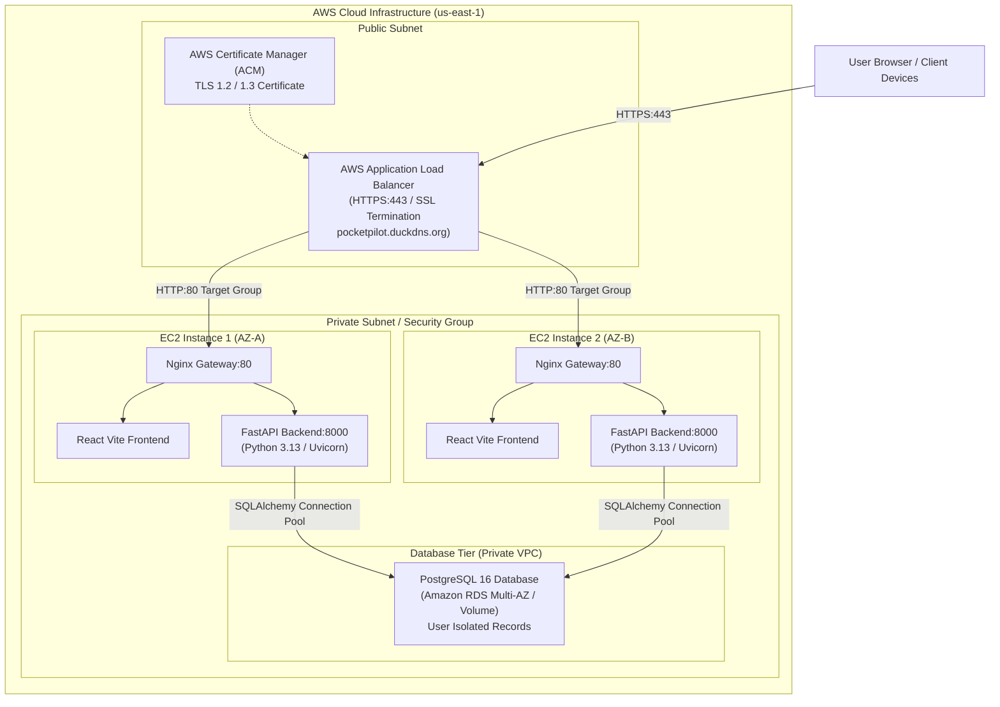

# PocketPilot Architecture Documentation

## 1. System Overview

**PocketPilot** is a production-style, multi-tier student financial management system designed to track student expenses, enforce category budgets, identify recurring subscription commitments, and detect spending anomalies using explainable statistical methods.

The architecture emphasizes:
- **Clean separation of concerns** between presentation, business intelligence, and persistence.
- **Strict multi-user data isolation** ensuring individual student records are inaccessible to other users.
- **Explainability**: All subscription and anomaly detections provide transparent, mathematically sound reasons without misleading claims of black-box machine learning.
- **Cloud-readiness**: Native support for containerization, reverse proxying, shared relational database storage, and AWS Application Load Balancer (ALB) multi-instance horizontal scaling.

---

## 2. High-Level Architecture Diagram

---

## 3. Component Breakdown

### A. Frontend Layer (React 18 + Vite + Tailwind CSS)
- **Framework**: React 18 with Vite for optimized builds and fast hot reloading.
- **Styling**: Tailwind CSS with a student-fintech color palette (Navy slate, Indigo, Emerald, Amber, Rose).
- **Visualization**: Recharts for interactive Donut spending charts and 6-month historical trend bar charts.
- **Icons**: Lucide React for consistent financial iconography.
- **Routing & State**: Context-based authentication state (`AuthContext.jsx`), token persistence in `localStorage`, and reactive view navigation.
- **Delivery**: Compiled to static HTML/CSS/JS and served through high-performance Nginx with cache headers for immutable assets.

### B. Gateway & Reverse Proxy (Nginx)
- **Role**: Entrypoint for all incoming HTTP requests.
- **Routing Rules**:
  - `/api/` &rarr; Reverse-proxied to FastAPI backend (`backend:8000`).
  - `/docs` & `/openapi.json` &rarr; Proxied to FastAPI OpenAPI documentation.
  - `/healthz` &rarr; Local 200 OK for load balancer health probes.
  - `/` &rarr; Static frontend SPA routing (`try_files $uri $uri/ /index.html`).
- **Security Headers**:
  - `X-Frame-Options: DENY` (clickjacking prevention)
  - `X-Content-Type-Options: nosniff` (MIME sniffing prevention)
  - `X-XSS-Protection: 1; mode=block`
  - `Strict-Transport-Security: max-age=31536000; includeSubDomains` (when SSL active)
  - `client_max_body_size: 10M` (prevents oversized payload denial-of-service)

### C. Backend API Layer (FastAPI + Python 3.13)
- **Framework**: FastAPI for asynchronous, type-safe REST APIs.
- **Authentication**: JWT tokens (HMAC-SHA256) with bcrypt password hashing (12 salt rounds).
- **Dependency Injection**: `get_current_user` enforces that every request extracts the authenticated student ID from the cryptographically verified JWT.
- **ORM**: SQLAlchemy 2.0 with connection pooling (`pool_pre_ping=True`, `pool_size=10`).
- **Validation**: Pydantic v2 schemas for request input validation, data sanitization, and response serialization.

### D. Analytical Services
1. **Subscription Detection Engine (`subscription_detector.py`)**:
   - Normalizes merchant strings (stripping card identifiers, corporate entities like LLC/Inc, and punctuation).
   - Groups user transactions and calculates consecutive day deltas ($\Delta t_i$).
   - Flags recurring patterns matching weekly (~7 days), monthly (~30 days), bi-weekly (~14 days), or yearly (~365 days) intervals.
   - Evaluates amount variance ($CoV = \frac{\sigma}{\mu}$) to distinguish fixed subscriptions from variable grocery/coffee visits.
2. **Explainable Anomaly Detector (`anomaly_detector.py`)**:
   - Uses leave-one-out statistical baseline estimation to prevent single-outlier variance inflation.
   - Flags transactions exceeding $\mu_{-i} + 2.5 \times \sigma_{-i}$ with documented mathematical explanations.
   - Applies small-sample median multipliers for sparse student categories.
3. **CSV Validation Engine (`csv_service.py`)**:
   - Uses Pandas for memory-safe tabular processing.
   - Enforces required columns (`date`, `merchant`, `category`, `amount`, `description`).
   - Implements duplicate detection across existing database signatures `(date, merchant, amount, description)`.
4. **Budget Monitor (`budget_service.py`)**:
   - Aggregates monthly expenditures by category.
   - Computes utilization percentage, remaining balance, and warning thresholds ($\ge 80\%$ warning, $\ge 100\%$ exceeded).

### E. Persistence Layer (PostgreSQL 16)
- **Database**: PostgreSQL 16 relational database with ACID guarantees.
- **Schema**:
  - `users`: User credentials, authentication hashes, timestamps.
  - `transactions`: Date, merchant, category, amount, description, payment method, foreign key `user_id`.
  - `budgets`: Category, monthly limit, month, year, foreign key `user_id` with composite unique constraint.
  - `subscriptions`: Merchant, category, amount, cycle, confidence score, status, explanation, foreign key `user_id`.
- **Database Indexes**: Optimized indexes on `(user_id, date)`, `(user_id, category)`, and `(user_id, merchant)` for fast analytical aggregations.
